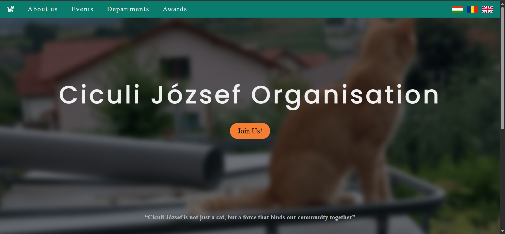

# Ciculi Jozsef Organisation Website

A static, multilingual website for Ciculi Jozsef Organisation, built with plain HTML, CSS, and JavaScript and self-hosted on a Raspberry Pi. All text is stored in separate JSON files and injected at runtime, making it possible for the site to be available in 3 languages: Hungarian, Romanian and English.

**Live site:** https://ciculijozsef.com


## Features

- 3 languages: Hungarian, Romanian and English, switchable without page reload
- Fully static
- Self-hosted on a Raspberry Pi

## Tech Stack

- HTML, CSS, JavaScript
- JSON for all text
- nginx for serving
- Raspberry Pi OS on Raspberry Pi

## Project Structure

```
D:.
|   README.md
\---frontend
    |   aboutUs.html
    |   awards.html
    |   departments.html
    |   events.html
    |   index.html
    +---assets
    |   +---fonts
    |   \---pictures
    +---css
    |       aboutUs.css
    |       awards.css
    |       departments.css
    |       events.css
    |       index.css
    |       main.css
    |
    +---js
    |       i18n.js    # loads the text
    |       navbar.js  # handles navbar on smaller screen sizes
    |
    \---lang           # contains the JSON files with the texts
            en.json
            hu.json
            ro.json
```

## How the Translation Works

Each language file holds the same set of keys, with the translated string for each:

```json
{
  "nav.aboutus": "About us",
  "nav.events": "Events",
  "nav.departments": "Departments",
  "nav.awards": "Awards",
  ...
}
```

Elements that need translated text are marked in HTML with a data attribute rather than containing the text directly:

```html
<li><a href="aboutUs.html" data-i18n="nav.aboutus"></a></li>
<li><a href="events.html" data-i18n="nav.events"></a></li>
<li><a href="departments.html" data-i18n="nav.departments"></a></li>
<li><a href="awards.html" data-i18n="nav.awards"></a></li>
```

```js
async function loadLanguage(lang) {
  const res = await fetch(`lang/${lang}.json`);
  const dict = await res.json();
  document.querySelectorAll('[data-i18n]').forEach(el => {
    const key = el.getAttribute('data-i18n');
    if (dict[key]) el.textContent = dict[key];
  });
  localStorage.setItem('lang', lang);
  document.documentElement.lang = lang;
}
```

## Deployment

The site runs on a Raspberry Pi I administer myself. It is served by nginx and exposed to the internet through a Cloudflare Tunnel, which is also how the site gets its HTTPS certificate.

  
